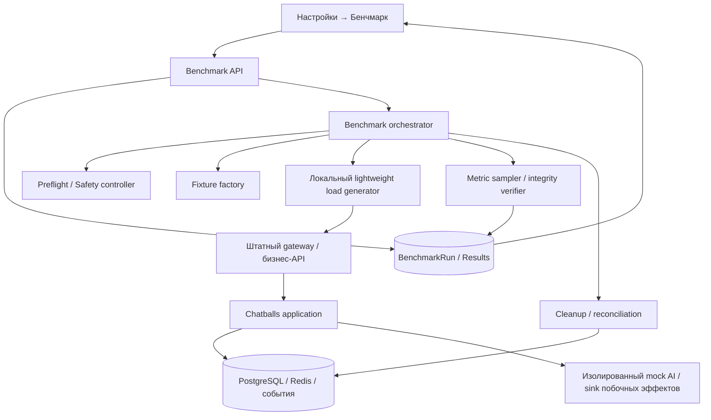

# Chatballs — встроенный бенчмарк производительности

**Техническое задание / спецификация для реализации**  
**Версия документа:** 1.0 (проект)  
**Дата:** 04.11.2026  
**Репозиторий:** https://github.com/dartdavros/chatballs  
**Статус:** к декомпозиции на задачи разработки  
**Приоритет:** продуктовая функция; не экспериментальный скрипт для разработчика

> **Основная идея.** Владелец любой установленной копии Chatballs открывает **Настройки → Бенчмарк**, нажимает **«Запустить тест»** и получает воспроизводимый отчёт о возможностях **своего сервера**. Ручное создание операторов, клиентов, каналов, агентов, сообщений, ключей AI или демо-данных не требуется.
>
> **Ограничение честности измерений.** Встроенный генератор работает на измеряемом сервере и сам потребляет ресурсы. Отчёт обязан отражать это и не представляться независимым внешним нагрузочным испытанием. На живой системе нельзя гарантировать нулевое влияние на реальных клиентов, а поиск предела может вызывать деградацию.

---

## 1. Цель и границы функциональности

### 1.1. Цель

Реализовать доступный владельцу установки **внутренний self-benchmark** Chatballs, который:

1. **Без предварительной настройки** работает после завершения первоначального мастера установки.
2. Работает с **ровно одной существующей организацией**, не создаёт вторую организацию.
3. Одинаково запускается на пустой базе, с демо-данными и на действующем production-инстансе с произвольными реальными данными.
4. Автоматически создаёт, использует и удаляет изолированные тестовые сущности, не изменяя реальные клиентские данные.
5. Нагружает настоящие бизнес-пути приложения (webchat, операторы, события и AI-конвейер с контролируемым заглушечным провайдером), а не только `/health`.
6. Измеряет **устойчивую пропускную способность, задержки, ошибки и использование ресурсов**, показывает предел деградации, если выбран соответствующий режим.
7. Формирует человекочитаемый отчёт в UI, хранит историю и обеспечивает экспорт результатов.
8. Поддерживает повторные запуски и сравнение результатов между версиями Chatballs и серверами **при соблюдении условий сопоставимости**.

### 1.2. Обязательные инварианты (блокирующие критерии)

**BEN-001.** Никаких ручных тестовых данных: ни демо-данные, ни созданные оператором каналы/агенты не являются предпосылкой.  
**BEN-002.** Одна организация; тест выполняется в её контексте и с соблюдением действующей модели прав и изоляции данных.  
**BEN-003.** Никаких сообщений в реальные Telegram/MAX/VK/email-каналы, настоящим клиентам и реальным AI-провайдерам по умолчанию; никакой платной внешней операции.  
**BEN-004.** Тестовые сущности нельзя показывать в реальных диалогах, уведомлениях, рабочих очередях, отчётности и пользовательском поиске.  
**BEN-005.** В любой исходной базе — пустой, демо или заполненной — запуск не должен менять реальных клиентов, сообщения, диалоги, настройки и права сотрудников.  
**BEN-006.** Каждый запуск управляется как долговечная операция с возможностью отмены и восстановления после падения процесса.  
**BEN-007.** После теста удаляются исключительно принадлежащие ему синтетические данные; результаты и диагностические метаданные сохраняются отдельно.  
**BEN-008.** Запуск на критически занятом сервере может быть отклонён предзапускной проверкой. Функция должна работать на **любом состоянии данных**, но это **не обещание принудительного запуска при аварийном состоянии ресурсов**.  
**BEN-009.** На живом production-инстансе даже «безопасный» режим не обещает нулевого влияния на клиентский трафик.  
**BEN-010.** Результаты, полученные при разных версиях методики, нагрузочных профилях или существенных условиях окружения, не маркируются как непосредственно сопоставимые.

### 1.3. Не входит в первую версию

- Распределённый генератор нагрузки и публичный облачный сервис сравнительных бенчмарков.
- Измерение реальных внешних AI-сервисов, качества их ответов и стоимости токенов.
- Нагрузочные испытания реальных Telegram/MAX/VK/SMTP/IMAP-провайдеров.
- Проверка работы полного звонкового/media-контура и внешних TURN-путей.
- Автоматическое масштабирование сервера или изменение пользовательского Docker Compose по итогам теста.
- Обещания SLA или «максимально поддерживаемого числа пользователей» без зафиксированного сценария активности.

Эти возможности могут добавляться независимо от базового self-benchmark.

---

## 2. Поддерживаемые состояния инстанса

| Исходное состояние | Ожидаемое поведение |
|---|---|
| Чистая установка после мастера: одна организация и владелец; больше ничего | Бенчмарк сам подготавливает всё необходимое и выполняет тест |
| Установлены демо-данные | Демо-данные не используются как обязательные входные; запуск изолирован |
| Реальные клиенты и активные операторы | Тестовые объекты скрыты и не затрагивают реальные диалоги; используется защитный режим по умолчанию |
| Большая история сообщений | Тест проходит в той же базе и фиксирует её объём и фоновую нагрузку как характеристики условий |
| Нет AI-ключа, агента или каналов | Создаётся внутренний синтетический сценарий и контролируемый mock AI; никакие внешние ключи не нужны |
| Предыдущий бенчмарк оборвался | Восстановление учёта, очистка остаточных объектов и возможность повторного старта |
| Мало свободной памяти/места, не работает важный сервис | Понятный `BLOCKED` с причиной; без попытки повредить систему |
| Мастер первичной настройки не завершён | Страница недоступна: нет созданной организации/владельца |

**Демо-данные не требуются и не должны влиять на возможность запуска.** Нужен отдельный фабричный набор синтетических данных, используемый только бенчмарком.

---

## 3. Пользовательский сценарий и интерфейс

### 3.1. Местоположение и доступ

- Новая страница: **Настройки → Бенчмарк**.
- Доступ к запуску, отмене, истории и экспорту — только владельцу организации либо выделенной административной роли с явным разрешением на нагрузочное тестирование.
- Страница показывает характеристики сервера, текущие условия, историю запусков и кнопку запуска.
- Из UI **не требуется** вводить IP, домен, токены, число организаций, число тестовых операторов или данные каналов.

### 3.2. Режимы

| Режим | Назначение | Правила |
|---|---|---|
| **Безопасный** (по умолчанию) | Ограниченная характеристика текущей установки | Контролируемый рост нагрузки; защитные пороги; ранний останов при ухудшении состояния; результат может быть «предел не найден» |
| **Предельный** | Поиск устойчивого максимума и точки деградации | Более высокие ступени нагрузки; явное подтверждение возможного влияния на клиентов; аварийные стоп-пороги продолжают действовать |

У пользовательской кнопки «Запустить тест» после выбора режима появляется предзапускное подтверждение, содержащее приблизительный сценарий **без обещания гарантированного времени завершения**. Для предельного режима требуется отдельное подтверждение риска.

### 3.3. Состояния UI

`IDLE` → `PREFLIGHT` → `PREPARING` → `WARMUP` → `RUNNING` → `VALIDATING` → `CLEANING` → `COMPLETED`.

Возможные терминальные состояния: `COMPLETED`, `PARTIAL`, `BLOCKED`, `FAILED`, `CANCELLED`.

`PARTIAL` означает, что часть измерений получена, но полный сценарий не завершён или произошёл защитный stop. Результат не должен отображаться как полноценный успешный benchmark.

На экране выполнения показать:

- текущий этап и сценарий (например, Webchat / операторы / AI pipeline);
- выполненную ступень нагрузки и текущие измерения;
- текущую нагрузку CPU/RAM, если метрики доступны;
- счётчики ошибок и принятых/проверенных сообщений;
- доступную кнопку **«Остановить»**;
- предупреждение о влиянии на текущую эксплуатацию.

После обновления страницы выполнение продолжается: состояние берётся из сервера, а не из памяти вкладки.

### 3.4. Результат на странице

Блоки в указанном порядке:

1. **Заголовок:** дата и время запуска, статус, режим, версия Chatballs и версия benchmark-профиля.
2. **Условия:** vCPU, RAM, диск, версия ОС, характеристики контейнеров, версия БД, объём существующей базы, CPU/RAM в простое, фоновая нагрузка, настройки и источник метрик.
3. **Главный результат:** устойчивая пропускная способность для конкретного сценария — `X сообщений/с при p95 Y мс, ошибок Z%`, либо честный статус «устойчивый предел не определён».
4. **Контекст результата:** сколько виртуальных операторов и активных сессий **участвовали в этом сценарии**. Эти значения не называть «максимумом поддерживаемых операторов» без отдельного теста на максимум.
5. **График деградации:** p50/p95/p99 в зависимости от интенсивности, ошибки и пропускная способность.
6. **Ресурсы:** CPU, RAM, swap/OOM, использование диска, рестарты, состояние очереди AI.
7. **Результаты по сценариям:** Webchat, Operators, WebSocket, AI, Mixed, Spike/Recovery.
8. **Корректность:** количество подтверждённых, найденных, потерянных и неожиданно продублированных сообщений.
9. **Вывод:** условия стабильной работы, точка деградации, предупреждения и ограничения методики.
10. **Действия:** повторный запуск, копирование краткого результата, экспорт JSON/CSV и PDF (PDF допускается отдельным этапом), просмотр истории.

### 3.5. Пример результата (НЕ результаты Chatballs)

> **ДЕМОНСТРАЦИОННЫЕ, ВЫМЫШЛЕННЫЕ ЧИСЛА** — только для разработки UI.
>
> **Бенчмарк сервера — завершён**  
> Сервер: **1 vCPU · 2 ГБ RAM · 30 ГБ SSD**  
> Сценарий: **смешанная нагрузка** · Режим: **предельный**  
> **Устойчивый поток: 2,0 сообщения/с**  
> При этой нагрузке: **p95 приёма сообщения 320 мс · ошибки 0%**  
> В сценарии участвовали: **6 виртуальных операторов, 40 активных клиентских сессий**  
> С **2,5 сообщения/с** началась деградация по выбранному порогу p95 500 мс  
> Потерянных подтверждённых сообщений: **0**  
> Пик RAM: **1,68 ГБ** · CPU: **94%**  
> Тестовые данные очищены: **да**  
> **Вывод:** сервер устойчив в испытанном профиле на 2 сообщения/с. Эта цифра не является гарантией для другой структуры трафика или внешних интеграций.

В итоговом UI для каждой цифры следует показывать источник и границы интерпретации. Нельзя подменять экспериментальные измерения расчётной «оценкой».

---

## 4. Архитектура

### 4.1. Компоненты



Компоненты логические; физическое размещение определяется текущей архитектурой Chatballs. **Не следует запускать тяжёлый k6 или Grafana внутри минимального VPS по умолчанию.**

### 4.2. Принцип реальности измерений

- Бизнес-операции должны проходить через **те же API и существенные обработчики**, что и обычные webchat/операторские сценарии.
- Исключения допустимы только на **границах побочных эффектов**: настоящий мессенджер, электронная почта, отправка уведомлений реальным пользователям, платный AI-провайдер.
- Нельзя просто вставлять миллионы записей SQL и объявлять это тестом скорости приёма сообщений: bulk-данные пригодны лишь для подготовки истории и проверки производительности запросов.
- Нельзя измерять только `/health` и выдавать цифру за производительность клиентского чата.
- Локальный генератор обязательно измеряет своё потребление CPU/RAM. В отчёте показатель типа генерации: `embedded/self-hosted`, источник трафика, путь через gateway, объём накладных расходов.
- Измерение по loopback/внутренней Docker-сети **не включает Интернет, внешнюю сеть и задержки реального провайдера**. Это явно обозначается.

### 4.3. Ограничения генератора на одном сервере

Для минимальной машины **1 vCPU / 2 ГБ / 30 ГБ SSD**:

1. Генератор должен быть лёгким, с ограниченным количеством потоков/соединений, без хранения всех ответов в RAM.
2. Сбор метрик — агрегированные гистограммы и короткие временные ряды, не безлимитный массив каждого запроса.
3. Накладные расходы runner измеряются отдельно. При значимой нагрузке генератора отчёт отмечается как `generator_limited` / «точность ограничена».
4. Если генератор перестаёт выдерживать запрошенную интенсивность, нельзя приписывать это приложению: отдельно показываются **запрошенная**, **фактически созданная** и **успешно завершённая** интенсивности.
5. Если пользователь позже подключит внешний генератор, измерения относятся к другому `generator_mode` и сравниваются только при совместимой методике.

### 4.4. Сбор ресурсов без привилегированного Docker socket

Функция **не должна требовать** доступ к `/var/run/docker.sock` или привилегированный контейнер только ради бенчмарка. По возможности использовать cgroup v2, `/proc`, ограниченные файловые статистики, метрики приложения и БД. Если часть системных метрик недоступна — показывать `N/A`, а не ноль и не догадку. Отдельные привилегированные диагностические интеграции допустимы позже с явным согласием администратора.

---

## 5. Изоляция синтетических данных

### 5.1. Модель данных

Предлагаемые сущности (названия и расположение следует согласовать с реальными моделями Django):

- `BenchmarkRun`: UUID, организация, инициатор, режим, статусы/времена, версии, параметры, причины остановки, снимок окружения.
- `BenchmarkFixture`: связь `run_id` с созданными тестовыми объектами; служебные индексы для целевой очистки.
- `BenchmarkScenarioResult`: сценарий, ступени, latency histogram, throughput, ошибки, результаты проверки целостности.
- `BenchmarkMetricSample`: компактные временные ряды метрик.
- `BenchmarkEvent` / `AuditLog`: старт, этапы, отмена, stop по ресурсам, cleanup, результат.

В существующих сущностях (диалог, сообщение, аккаунт, канал, агент, задача, событие) должен быть **надёжный способ** отличить синтетику от живых объектов и связать её с `run_id`. Предпочтительно явное типизированное поле/связь или строгая служебная область видимости. **Не** полагаться на текстовый префикс имени/темы сообщения.

### 5.2. Фабрика тестовых сущностей

Автоматически создавать **внутри существующей организации**:

- служебный webchat-канал, доступный только генератору текущего запуска;
- тестовые клиентские сессии и диалоги;
- синтетические сообщения с UUID и последовательными номерами для проверки доставки;
- тестовых операторов с внутренними временными учётными данными (без email-приглашений);
- при необходимости тестового агента, тестовые статьи базы знаний и контролируемый AI-маршрут;
- события и фоновые задачи, маркированные `benchmark_run_id`.

Все количества и распределения **детерминированы seed-значением** и версией профиля. Генератор подготавливает данные порционно и с лимитами по объёму диска/памяти. Основной сценарий не обязан создавать огромную базу; нагрузка по операциям и нагрузка по объёму истории — разные измерения.

### 5.3. Нулевые внешние побочные эффекты

До передачи тестового события наружу действует обязательный guard:

- тестовые данные не доставляются в реальные мессенджеры, почту, webhook, push/уведомления сотрудникам, реальную телефонию и платные AI API;
- тестовые операторы не участвуют в бизнес-распределении реальных обращений;
- тестовые объекты не попадают в обычную аналитику, поиск, списки и счётчики;
- тестовая AI-инференция направляется на **детерминированный mock**; при необходимости имитируются задержки 0,5 / 3 / 10 секунд, но это **не реальный AI latency benchmark**;
- защита от сторонних эффектов должна работать на уровне обработчиков событий и фоновых worker-процессов, а не только при HTTP-запросе.

### 5.4. Очистка, ошибки и перезапуск

- Состояние каждого запуска устойчиво записано в БД, включая фазу подготовки и фактически созданные объекты.
- При отмене: остановка генерации → ожидание или безопасная отмена незавершённых операций → закрытие соединений → проверка целостности → очистка.
- При падении процесса/сервера: при следующем штатном старте `reconciler` находит незавершённые `run_id`, завершает или отменяет зависшие задачи, удаляет только принадлежащие этим запускам данные.
- Повторная очистка **идемпотентна**. Ранее удалённый объект — не ошибка.
- Отчёты и аудит сохраняются в отдельных сущностях; `BenchmarkFixture` и синтетика удаляются.
- Если корректно очистить всё не удалось, показывать `CLEANUP_REQUIRED`, явное число оставшихся тестовых объектов и кнопку «Повторить очистку». **Нельзя** заявлять «очищено» без проверки.
- Любая очистка строго ограничена `run_id` и организацией. Запрещены неограниченные `DELETE` и пересоздание пользовательской БД.

---

## 6. Предзапускная проверка и защита production

### 6.1. Preflight

Проверить:

1. Пользователь имеет право запуска; нет другого активного бенчмарка.
2. Все критические сервисы и БД/Redis доступны, миграции завершены.
3. Достаточно свободной памяти, дискового пространства и системных дескрипторов для безопасного старта.
4. Утилизация CPU/RAM и фоновые ошибки не свидетельствуют о критическом состоянии.
5. Возможны создание/изоляция synthetic fixtures и безопасный перехват side effects.
6. Система способна получить хотя бы обязательные API-метрики и проверить результаты.
7. Нет зависшего предыдущего запуска, требующего незавершённой очистки.

Пороги должны быть конфигурируемыми, иметь безопасные значения по умолчанию и версионироваться вместе с методикой. На 1 vCPU / 2 ГБ начальные пороги нужны консервативные. **Не закреплять недоказанные цифры как обещание работоспособности**.

### 6.2. Stop conditions

Немедленный контролируемый stop при:

- риске OOM, критическом росте swap/давления памяти;
- нехватке дискового пространства относительно обязательного резерва;
- смерти/циклическом рестарте критического сервиса;
- резком росте ошибок, времени ответа или устойчивом накоплении AI-очереди;
- неспособности генератора обеспечить заданный поток;
- ручной отмене;
- превышении максимального времени, установленного профилем.

В **безопасном** режиме пороги строже, рост нагрузки прекращается раньше. В **предельном** режиме допускается контролируемая деградация, но защита от аварии/повреждения данных остаётся обязательной.

### 6.3. Влияние на рабочие запросы

- Нельзя гарантировать отсутствие влияния на реальный трафик; UI должен это сообщать.
- По возможности замерить p95 и ошибки реального трафика **агрегированно и без чтения персональных данных** до/во время теста; использовать как дополнительный guard, а не содержимое диалогов.
- На загруженной системе допустим результат «тест не начат из-за текущей нагрузки».
- Предельный режим требует отдельного подтверждения, что тест может повлиять на пользователей.

---

## 7. Нагрузочные сценарии и методика

### 7.1. Типы испытаний

| ID | Сценарий | Действие | Основная метрика |
|---|---|---|---|
| `BASELINE` | Простой | Снять ресурсы при отсутствии тестовой нагрузки | CPU/RAM/swap, фоновые ошибки |
| `WEBCHAT` | Клиентские сообщения | Создать сессию, отправить сообщение, прочитать и сверить историю | Подтверждённые сообщения/с; p95 приёма |
| `OPERATORS` | Работа операторов | Авторизация тестового сотрудника, список диалогов, просмотр, ответ, изменение статуса | p95 критических операций; ошибки |
| `WEBSOCKET` | Доставка событий | Поддерживать тестовые соединения и проверять доставку | Доля доставленных событий; p95 latency |
| `AI_PIPELINE` | AI / outbox | Отправка, постановка задачи, обработка mock AI, публикация ответа | End-to-end p95; длина/возраст очереди |
| `MIXED` | Совместная эксплуатация | Webchat + операторы + WS + mock AI по фиксированным долям | Устойчивая пропускная способность |
| `SPIKE_RECOVERY` | Всплеск и восстановление | Резко повысить поток, снизить обратно | Время восстановления; потери/дубли |
| `SOAK` | Длительная работа (расширенный профиль) | Несколько часов удерживать подтверждённую нагрузку ниже предела | Стабильность p95, память, утечки, рост очередей |

В каждой версии benchmark-профиля документировать точные доли операций, «время размышления» оператора, текстовую длину сообщений, распределения запросов, частоты poll/read и задержку mock AI. **Без этого результаты двух серверов нельзя достоверно сравнивать.**

### 7.2. Фиксированная интенсивность, а не только «N пользователей»

Для потоков сообщений использовать **open workload**: заданные arrivals/sec не уменьшаются автоматически при росте ответа сервера. Отдельно учитывать:

- целевую интенсивность (`offered_rps` / `offered_messages_per_sec`);
- фактически созданную (`generated_rps`);
- успешно **принятую и подтверждённую** (`completed_accepted_rps`);
- долю ошибок и таймаутов;
- backlog и длительность ожидания фоновых операций.

Для операторского сценария дополнительно фиксировать число одновременно работающих виртуальных операторов, а для WebSocket — активных соединений. **Устойчивый максимум операторов** можно объявлять только по отдельной ступенчатой серии, если такой тест включён в профиль.

### 7.3. Предлагаемые профили v1 (начальные, уточняются по результатам пилота)

**`quick-safe-v1`:** обязательная базовая проверка, короткий прогрев, несколько умеренных ступеней, сценарии Webchat/Operators/WS/AI, защитная остановка. При серьёзном фоновом трафике возможен неполный результат. Цель — ориентировочная характеристика без поиска абсолютного предела.

**`capacity-v1`:** baseline → прогрев → ступенчатый поиск с адаптивным уточнением → выдержка устойчивого уровня → spike/recovery → проверка целостности → очистка. Нагрузка повышается не по фиксированной бесконечной шкале, а до первого нарушения SLO или системного guard.

**`soak-v1` (расширенный профиль):** отдельный длительный прогон на уже установленной безопасной интенсивности (например, 4–6 часов), без поиска максимума. Измеряются долгосрочная стабильность p95, рост памяти, очередей и занятости диска. Не включается в быстрый запуск по умолчанию и требует явного подтверждения длительного воздействия на сервер.

**Параметры, подлежащие фиксации в конфиге профиля:** время прогрева, продолжительность ступени, максимальная ступень/скорость её повышения, количество виртуальных операторов, длительность подтверждения найденного устойчивого уровня, интервалы метрик, допустимые пороги ошибок/задержек/роста очередей, максимальные ресурсы fixtures. Все параметры сохранять в `BenchmarkRun`.

### 7.4. Критерии устойчивости ступени

Ступень считается устойчивой, если в течение её измеряемого интервала **одновременно**:

- ошибки запросов не превышают заранее заданный порог (начальный ориентир: < 1%);
- p95 приёма сообщения не превышает SLO профиля (начальный ориентир: < 500 мс);
- другие критические операции и WS-доставка удовлетворяют своим SLO;
- не теряются ранее подтверждённые сообщения; нет необъяснимых дубликатов;
- нет OOM/аварийных рестартов;
- объём и возраст AI-очереди не растут без стабилизации;
- фактическая нагрузка генератора близка к целевой, без saturation самого generator.

Пороги **предлагаемые для первой методики**, не заявленные возможности Chatballs. Ошибки 429 показывать отдельно: это может быть корректный rate limit, но не успешная обработка запросов. p95 проверять по каждой ключевой операции, а не только по среднему HTTP.

**Главная цифра отчёта:** максимальная **подтверждённо устойчивая** интенсивность на проверенных ступенях (с указанием профиля и интервала выдержки). Пиковая кратковременная интенсивность и точка деградации выводятся **отдельно**. Если устойчивый уровень не подтверждён, не отображать фиктивное значение.

### 7.5. Integrity verification

Для каждого созданного сообщения использовать уникальные `run_id`, `message_id`, монотонную последовательность и контрольную сумму полезной нагрузки (без персональных данных). Проверять:

- принято сервером → можно прочитать по штатному API / подтверждено в хранилище;
- на завершающем этапе все признанные принятыми сообщения найдены ровно в предусмотренном количестве;
- не произошло непредусмотренных дублей и некорректного порядка там, где порядок гарантирован;
- AI-ответы соответствуют заранее известной mock-траектории;
- после очистки не осталось синтетики текущего `run_id`.

Считать отдельно «HTTP-ошибка до подтверждения», «подтверждено, но не найдено» и «дубль из-за повторной отправки с согласованным idempotency key».

---

## 8. Метрики и достоверность

### 8.1. Обязательные

- **Нагрузка:** target/generated/completed messages/s, RPS по операциям, число активных тестовых сессий/операторов/WS.
- **Задержки:** p50/p95/p99 по бизнес-операциям, время AI end-to-end и ожидание очереди.
- **Ошибки:** по HTTP-кодам, timeout, отказам авторизации, rate limit 429, ошибкам фоновых обработчиков.
- **Целостность:** accepted/verified/lost/duplicates, результаты проверок очистки.
- **Ресурсы:** доступные CPU/RAM/swap/disk, OOM/restarts, ограничения cgroup, CPU/RAM самого генератора.
- **Окружение:** модель CPU если доступна, vCPU, RAM, дисковая файловая система, ОС/ядро, версия Chatballs, digest образа/commit, версия БД, benchmark-protocol version, профиль, режим.
- **Состояние данных:** примерные число диалогов/сообщений и размер БД до теста, наличие живой фоновой нагрузки. Сведения — агрегатные, без пользовательского содержимого.

### 8.2. Достоверность и сопоставимость

Для каждого отчёта рассчитывать **не оценку «крутизны сервера», а уровень достоверности**:

- `VALID`: профили и метрики полные; генератор держал заданную нагрузку; результат подтверждён выдержкой.
- `LIMITED`: результат полезен, но есть фактор, ограничивающий интерпретацию (высокая фоновая нагрузка, заметные накладные расходы генератора, недоступные метрики).
- `INVALID`: недостаточно данных, нарушена методика, обнаружено искажение нагрузки генератором или некорректная проверка целостности.

Два результата можно **строго сопоставлять** лишь при одинаковых версии методики/профиле, сопоставимых настройках приложения, типе генератора, условиях нагрузки и объёме фоновых данных. На заполненной базе результат обязательно подписывается как результат **конкретного инстанса**, а не эталон «чистой установки».

### 8.3. Экспорт

- Краткое резюме — копируемый текст.
- JSON — машиночитаемый отчёт с версиями, параметрами, стадиями, методикой, метриками, ограничениями.
- CSV — таблицы ступеней и временных рядов.
- PDF — человекочитаемый документ для администратора и тендерной документации; можно вывести второй очередью при сохранении полной JSON-модели.
- Без текстов клиентских сообщений, email, токенов, секретов, ключей API и персональных данных.

---

## 9. Проектируемый backend API

> Перечисленные URL и модели — **предложение для реализации**, а не утверждение о существующих маршрутах репозитория. Адаптировать к текущему стилю роутинга, ролей и сериализаторов Chatballs.

| Метод | Предлагаемый URL | Назначение |
|---|---|---|
| `GET` | `/api/v1/benchmark/overview/` | Права, доступность, summary сервера, история последних запусков |
| `POST` | `/api/v1/benchmark/runs/` | Создать запуск с `mode`, `profile_version` и idempotency key |
| `GET` | `/api/v1/benchmark/runs/{id}/` | Статус, текущая стадия, прогресс, финальные метрики |
| `POST` | `/api/v1/benchmark/runs/{id}/cancel/` | Запросить отмену |
| `POST` | `/api/v1/benchmark/runs/{id}/cleanup/` | Повторить очистку незавершённого запуска |
| `GET` | `/api/v1/benchmark/runs/{id}/export/?format=json` | Скачать структурированный результат |
| `GET` | `/api/v1/benchmark/runs/` | История с пагинацией |

Для прогресса использовать существующий канал событий, SSE или polling — по принятой архитектуре проекта. Не открывать анонимный публичный endpoint создания нагрузки.

Пример **схемы** возвращаемых данных (все числа ниже вымышлены):

```json
{
  "id": "00000000-0000-4000-8000-000000000042",
  "status": "COMPLETED",
  "mode": "capacity",
  "generator_mode": "embedded",
  "benchmark_protocol_version": "1.0.0",
  "profile_id": "capacity-v1",
  "chatballs_version": "<installed-version>",
  "environment": {
    "vcpu": 1,
    "ram_bytes": 2147483648,
    "disk_total_bytes": 32212254720,
    "existing_organizations": 1,
    "existing_conversations": null,
    "existing_messages": null,
    "background_load_note": "measured separately"
  },
  "summary": {
    "scenario": "MIXED",
    "sustained_messages_per_second": 2.0,
    "message_accept_p95_ms": 320,
    "http_error_rate": 0.0,
    "virtual_operators_at_sustained_rate": 6,
    "active_client_sessions_at_sustained_rate": 40,
    "degradation_detected_at_messages_per_second": 2.5,
    "integrity": {"accepted": 3600, "missing": 0, "unexpected_duplicates": 0},
    "confidence": "VALID",
    "generator_limited": false
  },
  "cleanup": {"state": "DONE", "remaining_fixture_objects": 0},
  "scenarios": [],
  "load_steps": [],
  "warnings": []
}
```

---

## 10. Безопасность, аудит и эксплуатация

- Только авторизованный администратор; применять действующие CSRF/permission/rate limit механизмы.
- Не более одного активного запуска на инстанс/организацию; глобальная блокировка должна переживать перезапуски.
- Запуск нельзя создать через произвольный внешний адрес/URL: запретить превращение benchmark в SSRF/DoS-инструмент.
- Временные учётные записи и токены короткоживущие, scoped к запуску, без выдачи прав на реальные объекты.
- Никакого свободного пользовательского кода в тестовом профиле; сервер принимает лишь разрешённые версии сценариев.
- Полный аудит «кто/когда/какой режим запустил, остановил и экспортировал».
- Синтетические данные не должны пересекаться с реальными ни в RLS-запросах, ни при маршрутизации событий, ни при расчёте метрик.
- Статус `FAILED` или `CANCELLED` не должен скрывать ошибки очистки.
- Историю результатов ограничить по retention: предлагаемый старт — последние 20 отчётов и ограниченные временные ряды; финальные значения и provenance — по отдельной политике хранения.
- Запуск не выполняет автоматические schema migrations или рестарт production-контейнеров.

---

## 11. План реализации

### Этап 1 — каркас и инварианты

- Модели `BenchmarkRun`, профили, состояния, аудит и разрешения.
- API запуска/статуса/отмены, глобальная блокировка.
- Preflight, базовые защитные пороги и долговечный orchestrator.
- Factory синтетических объектов внутри одной организации и надёжная очистка.
- Глобальный guard на внешние побочные эффекты и исключение synthetic objects из бизнес-интерфейсов.
- UI: страница, режимы, прогресс, отмена и ошибки.

**Этап принимается только после тестов** «пустая/демо/живая установка», «повторный запуск», «аварийное прерывание», «нет внешних отправок».

### Этап 2 — измерения MVP

- Baseline, WEBCHAT, OPERATORS и базовый WEBSOCKET.
- Лёгкий локальный generator, histogram latency, фиксация ресурсоёмкости самого генератора.
- Проверка целостности и JSON/CSV-отчёт.
- Сопоставимые версия профиля и seed; история запусков.

**Результат:** полностью автоматический, честно обозначенный embedded benchmark без AI.

### Этап 3 — AI и предел

- Контролируемый mock AI, сценарий `AI_PIPELINE`.
- `MIXED`, `SPIKE_RECOVERY`, адаптивное уточнение устойчивого предела.
- Отдельный расширенный профиль `SOAK` (длительное испытание) после подтверждения безопасности кратких сценариев.
- Дополнительные stop guards, верификация backlog/recovery.
- Графики и рекомендации в UI.

### Этап 4 — расширенная отчётность

- Экспорт PDF, сравнение запусков с проверкой сопоставимости.
- Диагностика перегруженного генератора и подробная история изменений.
- Отдельный внешний load-generator для официальной независимой оценки (без обязательности для обычного пользователя).

---

## 12. Критерии приёмки / Definition of Done

### 12.1. Функциональные

- [ ] На **чистой** установке после мастера владелец запускает бенчмарк одним действием, ничего не настраивая.
- [ ] То же на установке с демо-данными.
- [ ] То же на установке с реальными данными и активными клиентами, при условии успешного preflight.
- [ ] Во всех случаях используется **одна существующая организация**, новых организаций не создаётся.
- [ ] Нет требования реального AI API key, внешнего канала или ручного наполнения базы.
- [ ] По завершении тестовые диалоги/сообщения/аккаунты/события отсутствуют в штатных списках и базе; отчёт сохранён.
- [ ] Тестовые сообщения и уведомления **не доставлялись** реальным получателям и внешним интеграциям.
- [ ] Ошибка на любом этапе и перезапуск приложения не оставляют неуправляемый активный генератор; cleanup идемпотентен.
- [ ] Пользователь может остановить тест, обновить вкладку, вернуться к текущему запуску и просмотреть историю.

### 12.2. Измерительные

- [ ] Отображаются p50/p95/p99, фактически сгенерированная/выполненная интенсивность, ошибки и проверки потерь/дублей.
- [ ] Главная цифра выводится **только для подтверждённо устойчивой** ступени; отсутствие подтверждения отображается явно.
- [ ] Измеряются или честно обозначаются как недоступные CPU/RAM/disk и накладные расходы генератора.
- [ ] `SAFE` и `CAPACITY` имеют явные разные условия остановки; на критическом риске оба прерываются.
- [ ] Отчёт содержит версии ПО/профиля, seed, параметры нагрузки и условия измерений.
- [ ] JSON/CSV выгрузки не содержат секретов или реальных персональных данных.

### 12.3. Защитные

- [ ] Отдельный тест проверяет, что организация, реальные контакты и реальные данные остались неизменными **даже при исключении, timeout и SIGKILL** runner.
- [ ] Любое попытка провести synthetic-событие во внешний коннектор блокируется на boundary.
- [ ] Превышение ресурсов вызывает контролируемый stop и корректный `PARTIAL`/`FAILED`, без ложного «пройдено».
- [ ] Недостаточный диск/неработающая БД приводит к понятному `BLOCKED` без частично подготовленных объектов.
- [ ] Параллельный запуск двух benchmark невозможен.
- [ ] Удаление data fixtures строго ограничено `run_id`; исправность защиты подтверждается интеграционными тестами.

### 12.4. Минимальная матрица QA

| Среда | Ожидание |
|---|---|
| 1 vCPU / 2 ГБ RAM / 30 ГБ SSD, пустая установка | Бенчмарк выполняется или обоснованно отказывается по preflight; если заявлена поддержка этой конфигурации — команда должна довести штатный сценарий до успешного прохождения |
| Та же машина, demo fixtures | Бенчмарк выполняется независимо от демо-содержимого |
| Та же машина, искусственно заполненная база | Запуск не требует ручной подготовки; результат учитывает размер и состояние БД |
| Производственный макет с активным фоновым трафиком | Отсутствие реальных side effects; корректные предупреждения/stop guards |
| Другие CPU/RAM/SSD | Отчёты отражают реальную конфигурацию и не используют жёстко зашитые показатели |
| Прерванный процесс в каждой фазе | Reconciliation и повторная очистка работают |
| Несколько одновременных кнопок запуска | Создаётся ровно один активный run |
| Нет системных метрик | UI показывает отсутствие показателей и ограничение достоверности |

---

## 13. Ключевые проектные решения и вопросы перед кодированием

Ниже не вопросы к конечному пользователю — их решает команда реализации по структуре кода:

1. **Где хранить признак синтетики?** Требуется сквозной `run_id` или эквивалентная типизированная связка, способная пройти через API, обработчики событий и поиск.
2. **Как перехватить внешние побочные эффекты?** Предпочтительно единый guarded adapter/sink для benchmark-событий, а не разрозненные `if benchmark` в каждом коннекторе.
3. **Как запускать локальный generator на минимальной машине?** Отдельный контролируемый процесс/сервис с жёсткими лимитами; измерение собственного overhead, отсутствие тяжёлых telemetry-пакетов в production Compose.
4. **Как получать host metrics?** Без обязательного Docker socket; явная деградация качества отчёта при ограниченном доступе.
5. **Как исключить synthetic objects из пользовательской аналитики?** На уровне общих query managers/read models, подписчиков и отдельных запросов, включая кэш.
6. **Как определить стабильность и сопоставимость?** Версионированная спецификация профиля и строгая модель `VALID/LIMITED/INVALID`.
7. **Как моделировать случаи без настроенного канала/AI?** Внутренний ephemeral webchat + mock provider, не влияющие на штатные параметры организации.

**Запрещённый путь:** «создать ручных демо-пользователей, отправить в реальные каналы, запустить k6 снаружи и объявить это встроенной фичей». Это противоречит продуктовой цели.

---

## 14. Конечный результат для пользователя

Пользователь видит понятный ответ на четыре вопроса:

1. **Какова реальная устойчивая производительность моего сервера для указанного профиля нагрузки?**
2. **На какой интенсивности и из-за какого фактора начинается деградация?**
3. **Были ли ошибки, потерянные сообщения, проблемы AI-очереди или ресурсов?**
4. **Можно ли сравнить этот результат с предыдущим запуском после обновления или переноса сервера?**

**Критерий успешности фичи:** владелец Chatballs на любой штатно работающей установке после мастера, имея ровно одну организацию, нажимает кнопку, не создаёт никаких данных вручную, получает честный воспроизводимый результат, а тестовая синтетика полностью удаляется без воздействия на реальные клиентские данные. При недостаточных ресурсах система не имитирует успешный результат, а объясняет, почему тест остановлен или не может быть начат.

---

## 15. Приложение: связь с текущим продуктом

Исходный репозиторий: https://github.com/dartdavros/chatballs

- README описывает установку через Compose и первичный мастер с созданием организации и владельца, а также **опциональными** демо-данными. Это подтверждает, что benchmark не должен опираться на демо-наполнение.
- В продукте уже есть webchat, операторская часть, фоновые процессы, AI и инфраструктура Docker Compose. Бенчмарк следует интегрировать в действующую архитектуру, не создавать параллельный «игрушечный» чат для измерений.
- Перед реализацией инженеру нужно сопоставить предложенные API и логические сущности с действующими Django-приложениями, RLS/organization context, правилами event/outbox, gateway и frontend Settings.

**Важно:** это **спецификация новой функции**, а не утверждение, что перечисленные эндпоинты, модели и mock-провайдер уже существуют. Перечисленные демонстрационные показатели не являются измерениями Chatballs.
